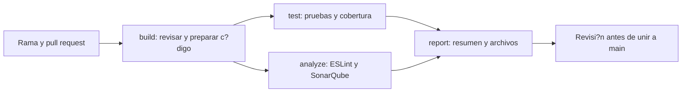

# Taller Mec?nico: proyecto de calidad de software

[](https://github.com/Luis-Adolfo-Gomez-Morales/Taller-Mecanico-SQA/actions/workflows/main.yml)
[](https://sonarcloud.io/dashboard?id=Luis-Adolfo-Gomez-Morales_Taller-Mecanico-SQA)

Este proyecto toma una aplicaci?n de escritorio que ya exist?a y le agrega controles de calidad. Permite registrar clientes, veh?culos, mec?nicos, repuestos y ?rdenes de trabajo. Tambi?n conserva el historial del veh?culo y calcula avisos de mantenimiento.

Se mantuvo Electron con JavaScript y MySQL porque era la base del proyecto anterior. No se cambi? a React y Express: el enunciado permite usar un proyecto de cursos anteriores y justificar otra tecnolog?a. Node.js ejecuta las pruebas, ESLint revisa el c?digo y GitHub Actions ejecuta las verificaciones. SonarQube Cloud est? conectado al repositorio mediante su integraci?n nativa.

## Instalaci?n y uso

Se necesita Node.js 22.14 o posterior de la serie 22 y acceso a MySQL. En las verificaciones se utiliz? Node.js 22.22.3. La aplicaci?n local conserva compatibilidad con MySQL 5.1; el pipeline usa una base temporal MySQL 8.0.

```powershell
git clone https://github.com/Luis-Adolfo-Gomez-Morales/Taller-Mecanico-SQA.git
cd Taller-Mecanico-SQA
npm ci
Copy-Item src/db-config.example.js src/db-config.js
```

Editar `src/db-config.js` con la conexi?n personal. El archivo est? excluido de Git. Tambi?n se pueden usar `DB_HOST`, `DB_PORT`, `DB_USER`, `DB_PASSWORD` y `DB_NAME` como variables de entorno. No escribir claves reales en los archivos que se suben.

Para una demostraci?n desde cero, se puede preparar una base vac?a con el esquema de pruebas:

```powershell
$env:DB_NAME = 'taller_demo_sqa_test'
npm run db:test:prepare
npm start
```

Esto crea un usuario llamado `usuario_sqa` con clave `clave-solo-de-prueba`. Sirve ?nicamente para la demostraci?n local. La preparaci?n se detiene si la base ya contiene tablas. No se debe usar esta cuenta en una instalaci?n real. Para una base que ya existe, revisar primero el [manual t?cnico](docs/Manual-Tecnico.md) y las migraciones.

En Windows, si Electron no abre por una variable del entorno, quitarla solo de la terminal actual con `Remove-Item Env:ELECTRON_RUN_AS_NODE -ErrorAction SilentlyContinue` y repetir `npm start`.

## Comprobar el proyecto

```powershell
npm run build
npm run lint
npm test
```

`npm test` ejecuta 59 pruebas sin necesitar MySQL. Para ejecutar las 60 pruebas y comprobar la cobertura, usar una base de pruebas preparada:

```powershell
$env:DB_NAME = 'taller_demo_sqa_test'
$env:RUN_DB_TESTS = '1'
npm run test:coverage
```

La prueba de integraci?n requiere MySQL y deshace sus escrituras al terminar. La cobertura m?nima es 60 % del c?digo de `src` cargado por las pruebas, sin incluir la configuraci?n privada ni los propios tests. El ?ltimo resultado local fue 77,10 %. Las pruebas de pantallas con datos simulados no significan que toda la interfaz tenga esa cobertura.

## Flujo en GitHub



El workflow est? en `.github/workflows/main.yml`. Se ejecuta al abrir o actualizar un pull request hacia `main`, al subir cambios a `main` y de forma manual. Si una prueba falla, hay advertencias de ESLint, la cobertura baja de 60 % o SonarQube no aprueba, el resultado final falla. En cada ejecuci?n se pueden descargar el c?digo preparado y los reportes desde **Artifacts**. La carpeta `build` contiene el c?digo para instalar; no es un instalador de Windows ni un despliegue en la nube.

La protecci?n obligatoria de `main` se configura en GitHub, no dentro del archivo YAML. Su estado y los pasos pendientes se explican en la [revisi?n de requisitos](docs/cumplimiento-requisitos.md).

## Documentaci?n

- [Plan SQA](docs/SQA_PLAN.md): objetivos, actividades, criterios y riesgos.
- [Matriz de pruebas](docs/matriz-pruebas.md): casos, entradas y resultados.
- [L?nea base](docs/Linea-Base-Calidad.md): medici?n del c?digo anterior.
- [Reporte de mejora](docs/Reporte-Mejora.md): comparaci?n antes y despu?s.
- [Manual t?cnico](docs/Manual-Tecnico.md): instalaci?n, pipeline y mantenimiento.
- [Manual de uso](docs/Manual-Uso.md): pasos para usar la aplicaci?n.
- [Deuda t?cnica](docs/deuda-tecnica.md): problemas pendientes y prioridades.
- [Revisi?n del enunciado](docs/cumplimiento-requisitos.md): requisitos completados y pendientes.

La presentaci?n, el PDF y el video se entregan por separado en la plataforma del curso y est?n excluidos del repositorio. Como el repositorio es privado, el docente necesita una invitaci?n para poder revisarlo.
