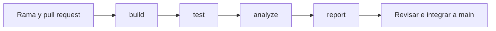

# Taller Mecánico

[](https://github.com/Luis-Adolfo-Gomez-Morales/Taller-Mecanico-SQA/actions/workflows/main.yml)
[](https://sonarcloud.io/dashboard?id=Luis-Adolfo-Gomez-Morales_Taller-Mecanico-SQA)

Este proyecto usa una aplicación de escritorio que ya existía y le agrega pruebas y revisiones de calidad. La aplicación permite registrar clientes, vehículos, mecánicos, repuestos y órdenes de trabajo. También guarda el historial de los vehículos y muestra avisos de mantenimiento.

Se mantuvieron Electron, JavaScript y MySQL porque eran las herramientas del proyecto anterior. El enunciado permite reutilizar un proyecto de otros cursos. Para revisar los cambios se usan Node.js, ESLint, Playwright, GitHub Actions y SonarQube Cloud.

## Instalar y abrir

Se necesita Node.js de la serie 22, versión 22.14 o posterior, y acceso a MySQL. Las pruebas se ejecutaron con Node.js 22.22.3. La aplicación usa Electron 45.2.3. La base local conserva compatibilidad con MySQL 5.1 y GitHub utiliza MySQL 8.0 para las pruebas.

```powershell
git clone https://github.com/Luis-Adolfo-Gomez-Morales/Taller-Mecanico-SQA.git
cd Taller-Mecanico-SQA
npm ci
Copy-Item src/db-config.example.js src/db-config.js
```

Editar `src/db-config.js` con los datos de la conexión personal. Este archivo queda fuera de Git. Después ejecutar `npm start`.

Para una demostración con datos ficticios se puede preparar una base vacía:

```powershell
$env:DB_NAME = 'taller_demo_sqa_test'
npm run db:test:prepare
npm start
```

La cuenta de demostración es `usuario_sqa` y su clave es `clave-solo-de-prueba`. Solo se usa en la base de pruebas. El comando se detiene si ya existen tablas. Para una instalación anterior, consultar el [manual técnico](docs/Manual-Tecnico.md) antes de aplicar migraciones.

Si Electron no abre en Windows, quitar la variable de esa terminal con `Remove-Item Env:ELECTRON_RUN_AS_NODE -ErrorAction SilentlyContinue` y volver a ejecutar `npm start`.

## Revisar los cambios

```powershell
npm run build
npm run lint
npm test
```

`npm test` ejecuta 66 casos sin necesitar un servidor MySQL. Para incluir la integración real y comprobar la cobertura:

```powershell
$env:DB_NAME = 'taller_demo_sqa_test'
$env:RUN_DB_TESTS = '1'
npm run test:coverage
npm run test:e2e
```

La primera prueba ejecuta 67 casos y exige un mínimo de 60 % de cobertura del código medido. La segunda abre Electron y realiza un recorrido completo por las pantallas. Se usa una base separada con datos ficticios; el recorrido de pantallas deja esos registros en la base de prueba.

## Resultados finales

| Revisión | Resultado |
|---|---|
| Pruebas con integración real | 67 aprobadas, 0 fallidas |
| Recorrido de las pantallas | Aprobado |
| ESLint | 0 errores y 0 advertencias |
| Cobertura de líneas medida por Node.js | 80,27 % |
| Cobertura del código nuevo en SonarQube | 85,81 % |
| Control de calidad de SonarQube | Passed |
| Pipeline | build, test, analyze y report aprobados |

Los dos porcentajes de cobertura tienen distinto alcance. SonarQube también muestra una cobertura general de 42,8 % y una duplicación general de 7,4 %. Estas medidas se explican en el [reporte de mejora](docs/Reporte-Mejora.md).

## Flujo de revisión



Build prepara el código. Test ejecuta las pruebas y el recorrido de pantallas. Analyze revisa ESLint y envía la cobertura a SonarQube. Report guarda el resumen. Si un control obligatorio falla, el cambio no puede integrarse a `main`.

La rama principal está protegida y el repositorio es público. En [GitHub Actions](https://github.com/Luis-Adolfo-Gomez-Morales/Taller-Mecanico-SQA/actions/runs/41952310669) se puede consultar la ejecución final del código y descargar sus archivos durante 14 días.

## Documentos y capturas

- [Plan de calidad](docs/SQA_PLAN.md).
- [Matriz de pruebas](docs/matriz-pruebas.md).
- [Línea base](docs/Linea-Base-Calidad.md).
- [Reporte de mejora](docs/Reporte-Mejora.md).
- [Manual técnico](docs/Manual-Tecnico.md).
- [Manual de uso](docs/Manual-Uso.md).
- [Revisión de las pantallas](docs/verificacion-funcional.md).
- [Mejoras pendientes](docs/deuda-tecnica.md).
- [Capturas y evidencias](docs/evidencias/README.md).

La presentación, el documento PDF y el video se entregan por separado en la plataforma del curso.
