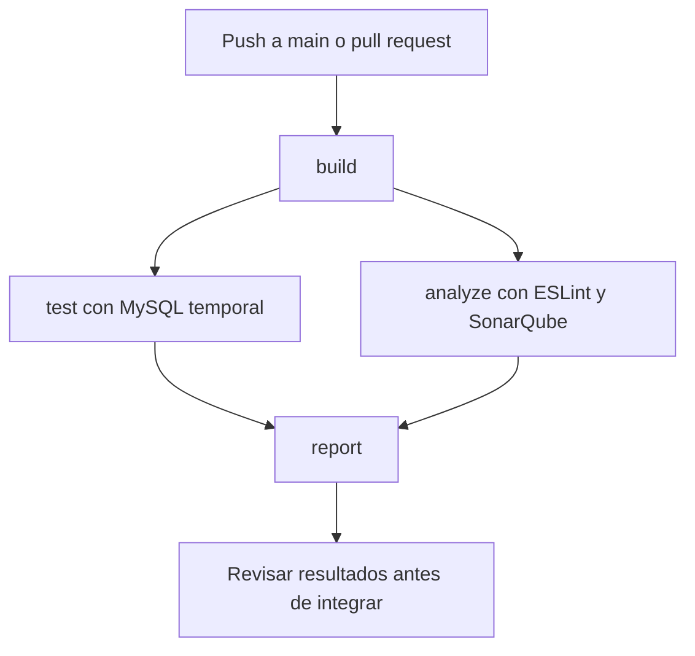

# Manual t?cnico

## Estructura del proyecto

La aplicaci?n tiene dos partes de Electron: el proceso principal abre la ventana y atiende las solicitudes, y las pantallas muestran la informaci?n. `src/preload.js` permite que las pantallas llamen a las operaciones autorizadas. MySQL guarda la informaci?n.

| Archivo o carpeta | Para qu? sirve |
|---|---|
| main.js | Abre la aplicaci?n y conecta las solicitudes con las operaciones |
| src/preload.js | Comunica las pantallas con el proceso principal |
| src/database.js | Consulta y guarda clientes, veh?culos, ?rdenes y repuestos |
| src/maintenance-rules.js | Revisa kilometraje y calcula mantenimiento |
| src/maintenance-layer.js | Consulta servicios y conserva operaciones de mantenimiento |
| src/config.js | Lee la configuraci?n personal o las variables del entorno |
| src/views, src/scripts y src/styles | Pantallas, acciones y apariencia |
| tests | Casos autom?ticos, simulaciones y prueba real de MySQL |
| scripts | Preparaci?n del c?digo, base de pruebas y reportes |

`createDatabase(pool)` permite usar las mismas operaciones con una conexi?n real de prueba. As? no hace falta leer un archivo JavaScript y ejecutarlo como texto.

## Instalaci?n

Seguir el README. `npm ci` instala lo registrado en package-lock.json y permite descargar Electron para abrir la aplicaci?n. En GitHub se usa `npm ci --ignore-scripts` porque las verificaciones no abren la ventana de Electron.

Copiar `src/db-config.example.js` como `src/db-config.js` solo para el equipo local. Las variables DB_HOST, DB_PORT, DB_USER, DB_PASSWORD y DB_NAME tienen prioridad. El archivo personal nunca se copia a build ni se incluye en Git. Una instalaci?n nueva puede usar el esquema vac?o de pruebas siguiendo el README; las cuentas creadas all? son ?nicamente de demostraci?n.

## Base de datos

`tests/fixtures/schema.sql` contiene el esquema actual sin registros reales. Se obtuvo de la estructura local y no incluye contrase?as ni datos de clientes. `npm run db:test:prepare` solo admite nombres terminados en `_sqa_test` y se detiene si encuentra tablas existentes. No borra una base para volver a crearla.

Las migraciones 03 y 07 a 16 documentan la evoluci?n de una instalaci?n antigua de MySQL 5.1. No se deben ejecutar todas sin comprobar antes cu?les ya se aplicaron. La migraci?n 13 elimina las vistas antiguas de pilotos y propietarios, y la 16 incorpora el descuento de repuestos. El esquema 01 es una propuesta anterior y no representa la instalaci?n actual completa.

Las pruebas locales se hicieron en una base separada sobre MySQL 5.1. El workflow prepara MySQL 8.0 dentro de GitHub Actions. Esa base se elimina con el entorno de ejecuci?n. Su contrase?a se genera por separado y se guarda en el secreto CI_MYSQL_PASSWORD de GitHub; no est? escrita en el workflow. No se conecta con la base del taller.

## Pipeline

Build revisa la sintaxis de JavaScript y prepara una carpeta de entrega. No genera un instalador ni comprueba que Electron abra. Test ejecuta la suite y exige 60 % de l?neas cubiertas. Analyze exige cero advertencias y consulta el control `SonarCloud Code Analysis` del mismo commit. Espera como m?ximo cinco minutos y falla si no recibe aprobaci?n. Report se ejecuta incluso cuando una etapa falla, publica un resumen y conserva los archivos disponibles.

Los archivos descargables son `codigo-preparado`, `resultados-pruebas` y `reporte-calidad`. Se guardan 14 d?as. En una ejecuci?n fallida puede faltar un archivo si la etapa que deb?a generarlo no lleg? a ejecutarse.

## SonarQube

El proyecto usa la integraci?n nativa que ya est? conectada a GitHub. No necesita SONAR_TOKEN en este modo. El script de comprobaci?n consulta GitHub con el token temporal de Actions, que solo tiene permiso de lectura.

El an?lisis autom?tico de SonarQube no admite importar cobertura. El LCOV queda disponible como archivo de la ejecuci?n. Para mostrarlo en el dashboard hay que desactivar el an?lisis autom?tico, configurar an?lisis desde CI y guardar el token en los secretos de GitHub. No se deben ejecutar ambos m?todos a la vez. Referencia: [cobertura de JavaScript en SonarQube](https://docs.sonarsource.com/sonarqube-cloud/analyzing-source-code/test-coverage/javascript-typescript-test-coverage).

## Protecci?n de main y revisi?n

La ?ltima consulta indic? `protected: false`; el acceso al ajuste de protecci?n devolvi? HTTP 403. GitHub respondi? que se necesita GitHub Pro o hacer p?blico el repositorio para activar esta funci?n. No basta con agregar un workflow para proteger una rama.

Cuando la cuenta lo permita, entrar en Settings, Branches o Rules y crear una regla para main. Exigir pull request y los controles build, test, analyze, report y SonarCloud Code Analysis. Desactivar saltos de la regla por administradores y bloquear borrado y force push. Si trabaja otra persona, pedir al menos una aprobaci?n. En trabajo individual no se debe inventar una aprobaci?n ajena ni bloquear el proyecto esperando la aprobaci?n del propio autor.

Hasta que se confirme esa regla, la protecci?n obligatoria sigue pendiente. No cambiar la privacidad del repositorio sin decisi?n del propietario. Referencia: [ramas protegidas de GitHub](https://docs.github.com/en/repositories/configuring-branches-and-merges-in-your-repository/managing-protected-branches/about-protected-branches).

## Mantenimiento y soluci?n de problemas

Despu?s de cambiar el c?digo ejecutar build, lint y las pruebas. Si cambia un comportamiento, actualizar su caso y la matriz. No bajar el porcentaje m?nimo para ocultar un fallo.

Si falta db-config.js en GitHub, src/config.js utiliza el ejemplo y las variables del workflow. Si la base de pruebas ya existe, usar otra base vac?a o revisar su contenido; el script no la limpia. Si SonarQube no responde, revisar su conexi?n y el commit analizado. Si falla el reporte, revisar primero test y analyze.

Una nueva dependencia se agrega junto con package-lock.json y se prueba con npm ci. Las capturas, PDF y grabaci?n para la entrega se mantienen fuera de GitHub.
