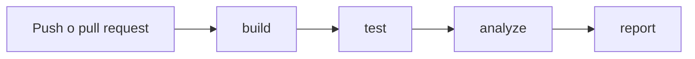

# Manual técnico

## Cómo está organizado

La aplicación usa Electron para abrir las pantallas y MySQL para guardar los datos. JavaScript contiene las acciones de los formularios y las reglas del taller.

| Archivo o carpeta | Función |
|---|---|
| `main.js` | Abre la ventana y recibe las solicitudes de las pantallas |
| `src/preload.js` | Comunica las pantallas con las operaciones autorizadas |
| `src/database.js` | Consulta y guarda la información |
| `src/maintenance-rules.js` | Revisa kilometraje y mantenimiento |
| `src/passwords.js` | Comprueba las claves y genera sus hashes |
| `src/config.js` | Lee la conexión personal o las variables del entorno |
| `src/views`, `src/scripts`, `src/styles` | Pantallas, acciones y apariencia |
| `tests` | Pruebas de funciones, integración y recorrido de pantallas |
| `scripts` | Preparación del código, base de prueba y reportes |

Las pruebas pueden pasar su propia conexión mediante `createDatabase(pool)`. Esto permite comprobar las operaciones sin usar la base real del taller.

## Instalación y conexión

Seguir las instrucciones del README. Se usaron Node.js 22.22.3 y Electron 45.2.3. `npm ci` instala las versiones guardadas en `package-lock.json` y descarga Electron.

Copiar `src/db-config.example.js` como `src/db-config.js` y colocar allí la conexión personal. El archivo no se sube a Git ni se copia a build. Las variables `DB_HOST`, `DB_PORT`, `DB_USER`, `DB_PASSWORD` y `DB_NAME` tienen prioridad cuando están definidas.

El esquema vacío está en `tests/fixtures/schema.sql`. Para prepararlo usar `npm run db:test:prepare` con una base cuyo nombre termine en `_sqa_test`. El comando se detiene si ya hay tablas. Los datos de inicio son ficticios y solo sirven para pruebas.

Las migraciones 03 y 07 a 16 muestran cómo cambió la instalación antigua. Antes de aplicarlas hay que revisar qué cambios ya existen y hacer un respaldo. La lista está en [mysql51-migracion.md](mysql51-migracion.md).

## Ejecución de pruebas

| Comando | Qué comprueba |
|---|---|
| `npm run build` | Sintaxis y preparación de la carpeta de entrega |
| `npm run lint` | Código sin errores ni advertencias de ESLint |
| `npm test` | 66 casos sin un servidor MySQL real |
| `npm run test:coverage` | 67 casos y cobertura, con `RUN_DB_TESTS=1` y la base de prueba preparada |
| `npm run test:e2e` | Recorrido completo de las pantallas con MySQL real |

La integración real deshace sus cambios al terminar. El recorrido de pantallas deja los registros ficticios en la base de prueba. En Linux se usa `xvfb-run -a npm run test:e2e` para disponer de una pantalla durante la ejecución.

## Pipeline

Build prepara el código. Test crea una base temporal MySQL 8.0, ejecuta las pruebas, exige 60 % de cobertura y recorre las pantallas. Analyze ejecuta ESLint y envía el código y `coverage/lcov.info` a SonarQube. Espera el resultado del control de calidad antes de aprobar. Report guarda el resumen, incluso si otra etapa falla.

Build prepara archivos para instalar la aplicación; no genera un instalador de Windows. Las descargas de Actions se llaman `codigo-preparado`, `resultados-pruebas` y `reporte-calidad`, y duran 14 días.

## Configuración de SonarQube y secretos

El análisis se ejecuta desde GitHub Actions y el análisis automático de SonarQube está desactivado. El archivo `.sonar-ci.properties` indica el proyecto y la ubicación de la cobertura. La variable `SONAR_CI_ENABLED=true` activa este modo.

Los secretos del repositorio son `SONAR_TOKEN` y `CI_MYSQL_PASSWORD`. Sus valores se guardan en GitHub, no en el código. Si el token vence, se reemplaza allí y se vuelve a ejecutar el workflow. Referencia: [cobertura de JavaScript en SonarQube](https://docs.sonarsource.com/sonarqube-cloud/analyzing-source-code/test-coverage/javascript-typescript-test-coverage).

La cobertura general del panel considera más archivos que el reporte de Node.js. Para explicar los resultados se deben usar los nombres completos de cada medida.

## Seguridad y mantenimiento

Las claves nuevas se guardan con scrypt. Las cuentas que aún tenían una clave antigua se actualizan al entrar correctamente, conservando la contraseña del usuario. No se hizo una modificación masiva de las cuentas reales.

`main` exige pull request y los controles build, test, analyze, report y SonarCloud Code Analysis. La regla también se aplica al administrador. Después de cambiar el código hay que repetir las comprobaciones y revisar el pull request antes de integrarlo.

Si una consulta falla, revisar la conexión. Si la base de prueba ya tiene tablas, elegir otra base vacía en lugar de borrar datos sin revisar. Si falla SonarQube, revisar el secreto, el método de análisis y el mensaje de la etapa analyze.

Las [capturas finales](evidencias/README.md) muestran una ejecución comprobada. Las mejoras pendientes están en [deuda-tecnica.md](deuda-tecnica.md).
