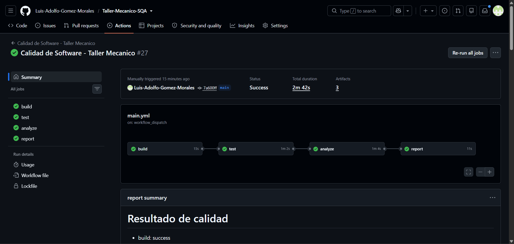
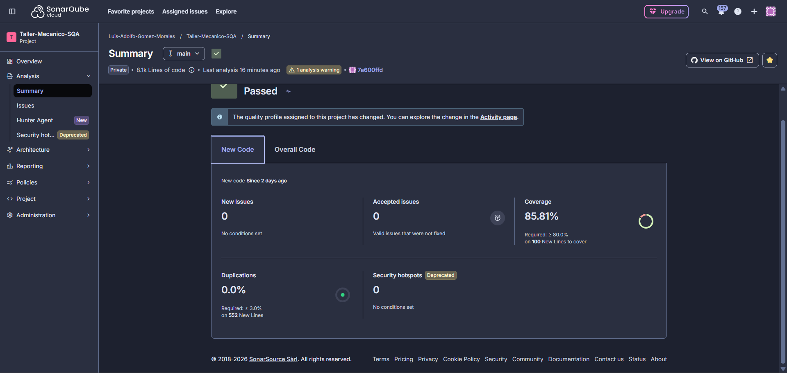
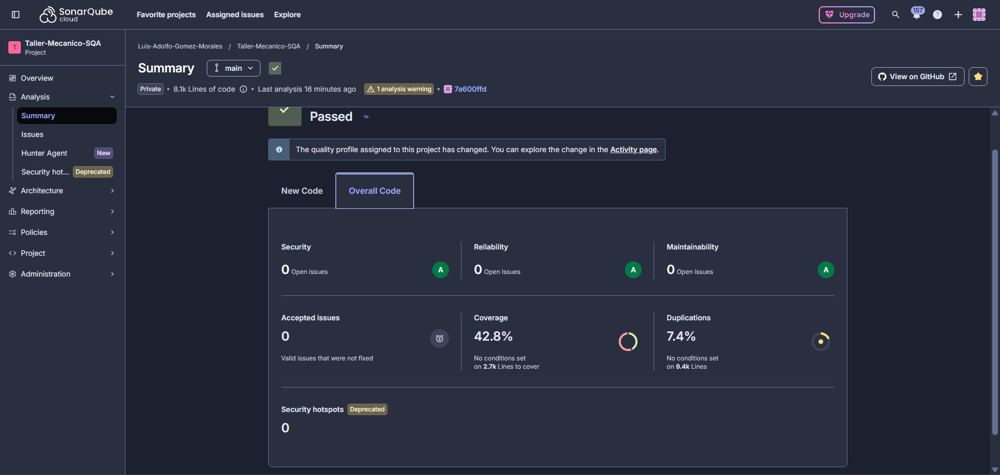
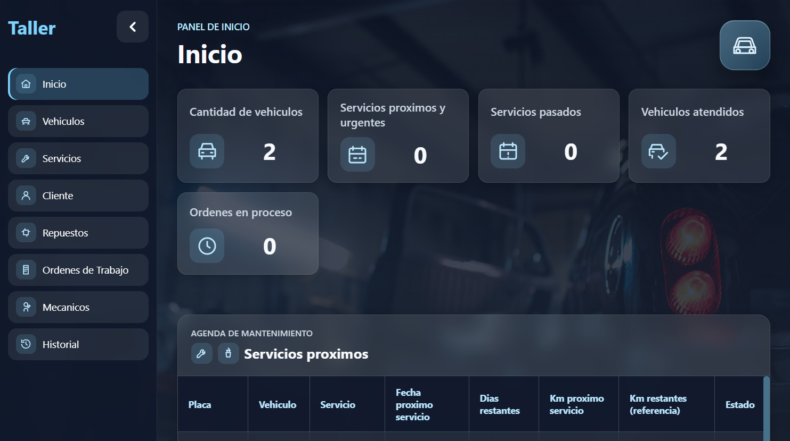
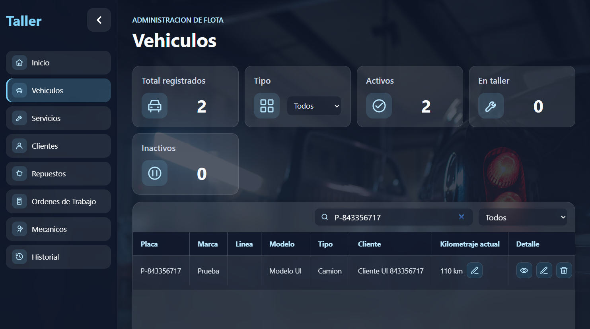
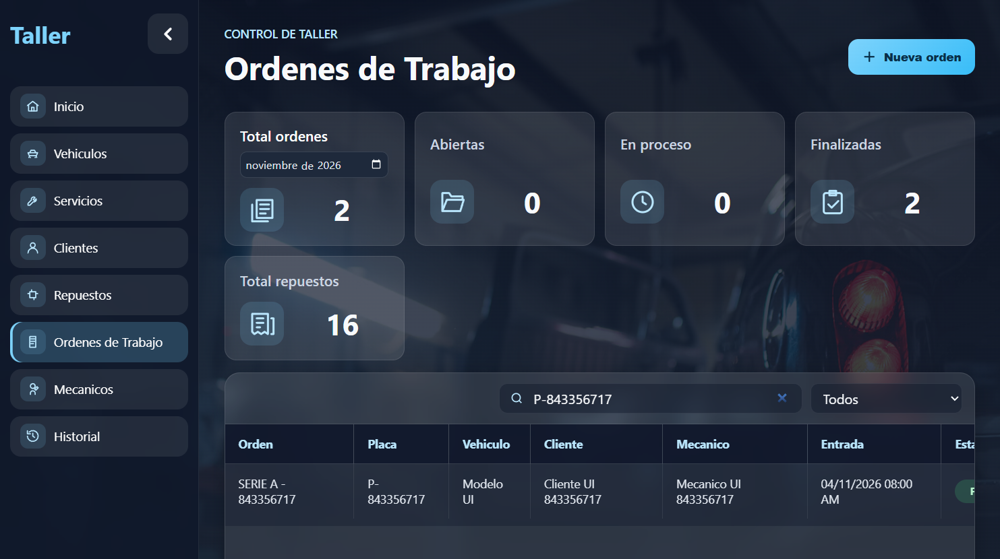
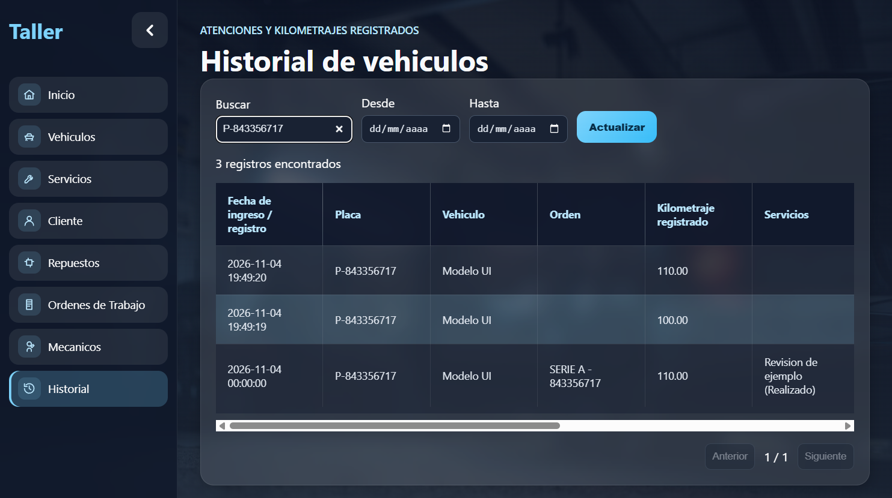
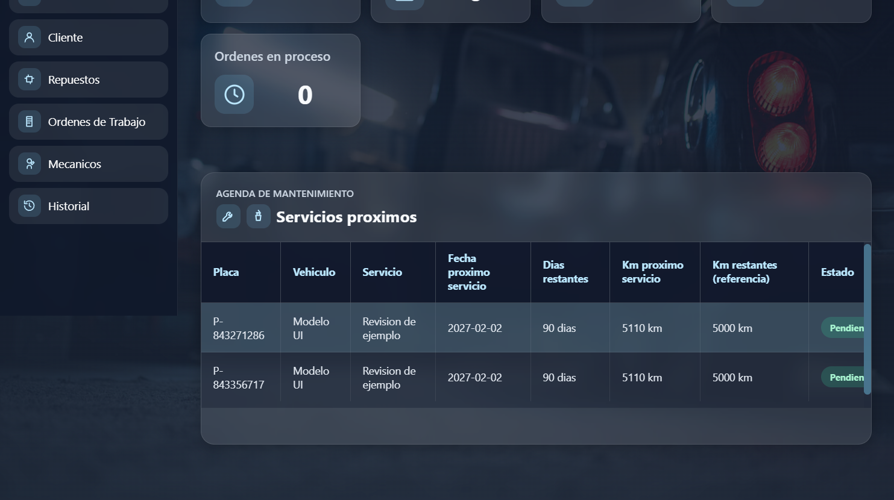

# Evidencias finales

Capturas reales guardadas el 4 de noviembre de 2026. El código revisado es el commit `7a600ff` y la ejecución final es [41952310669, número 27](https://github.com/Luis-Adolfo-Gomez-Morales/Taller-Mecanico-SQA/actions/runs/41952310669).

Las imágenes del pipeline y SonarQube se capturaron directamente desde sus páginas. Las pantallas de la aplicación corresponden al recorrido con una base separada y datos ficticios. No incluyen claves de acceso.

## Pipeline aprobado

Las cuatro etapas terminaron correctamente. La captura también muestra la rama, el commit y los tres archivos descargables.

## SonarQube: código nuevo

El control aprobó. La cobertura del código nuevo es 85,81 %, la duplicación es 0,0 % y no hay incidencias nuevas.

## SonarQube: código general

Esta vista muestra otra medida: 42,8 % de cobertura general y 7,4 % de duplicación general. Las tres categorías de incidencias abiertas aparecen en cero. Se conserva el aviso de análisis que muestra el panel.

## Aplicación funcionando

Las capturas siguientes corresponden al recorrido de prueba, no a registros del taller.

| Pantalla | Qué muestra |
|---|---|
| [Inicio](capturas/04-inicio.png) | Acceso correcto al panel |
| [Vehículo](capturas/05-vehiculo.png) | Registro vinculado con su cliente |
| [Orden](capturas/06-orden.png) | Atención registrada desde el formulario |
| [Historial](capturas/07-historial.png) | Atención y kilometrajes conservados |
| [Mantenimiento](capturas/08-mantenimiento.png) | Aviso del vehículo atendido |

## Archivos de resultados

- [Pruebas finales](pruebas-finales.txt): 67 aprobadas y cobertura de líneas de 80,27 %.
- [Recorrido de pantallas](recorrido-pantallas.txt): recorrido completo aprobado.
- [Datos de la ejecución](resultado-remoto.json): identificación del código y resultados.
- [ESLint final](eslint-final.txt): revisión sin errores ni advertencias.
- [Build final](build-final.txt): preparación correcta del código.
- [ESLint inicial](linea-base-eslint.txt) y [pruebas iniciales](linea-base-pruebas.txt): medición del commit `d915beb`.

El archivo `cobertura-dos-archivos-intermedia.txt` conserva una revisión anterior limitada a dos archivos. No es el reporte final de las 67 pruebas.

Estas evidencias se pueden usar en la presentación y en el video, que se entregan fuera de GitHub.
