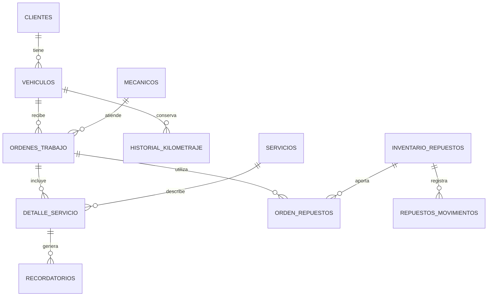

# Modelo de datos actual

La tabla `clientes` guarda las personas y empresas. Cada veh?culo se relaciona con un cliente mediante `id_cliente`. El nombre manual del propietario del veh?culo puede ser distinto al del cliente vinculado.

Las relaciones evitan guardar referencias a registros que no existen. Las placas son ?nicas. No se puede eliminar un cliente con veh?culos vinculados ni un veh?culo que tenga ?rdenes o historial que deba conservarse.

Las ?rdenes guardan una copia de algunos datos del veh?culo para conservar c?mo estaban al atenderlo. El historial registra las lecturas de kilometraje. Los servicios preventivos guardan una pr?xima fecha y los recordatorios usan esa fecha para avisar.

Las vistas antiguas `pilotos` y `propietarios` fueron parte de una transici?n y se retiran en la migraci?n 13. El c?digo actual consulta `clientes`; algunos nombres antiguos siguen en archivos y mensajes internos para mantener la comunicaci?n entre las pantallas.

El esquema vac?o actual est? en `tests/fixtures/schema.sql`. No contiene datos reales. Los archivos 03 y 07 a 16 muestran la evoluci?n de una instalaci?n anterior; no se deben repetir sin revisar primero su estado.
