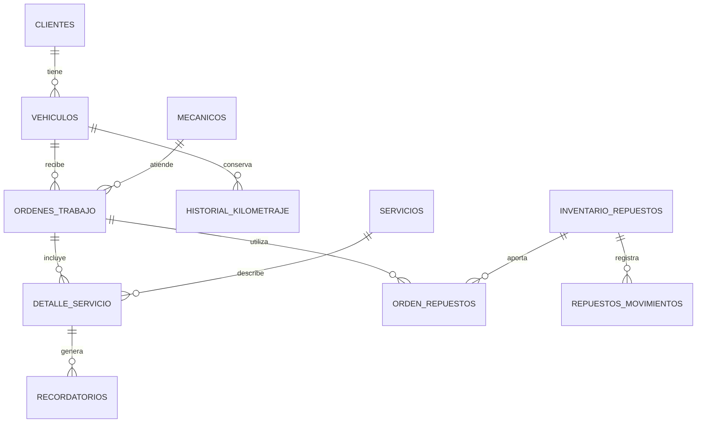

# Modelo de datos actual

La tabla `clientes` guarda las personas y empresas. Cada vehículo se relaciona con un cliente mediante `id_cliente`. El nombre manual del propietario del vehículo puede ser distinto al del cliente vinculado.

Las relaciones evitan guardar referencias a registros que no existen. Las placas son únicas. No se puede eliminar un cliente con vehículos vinculados ni un vehículo que tenga órdenes o historial que deba conservarse.

Las órdenes guardan una copia de algunos datos del vehículo para conservar cómo estaban al atenderlo. El historial registra las lecturas de kilometraje. Los servicios preventivos guardan una próxima fecha y los recordatorios usan esa fecha para avisar.

Las vistas antiguas `pilotos` y `propietarios` fueron parte de una transición y se retiran en la migración 13. El código actual consulta `clientes`; algunos nombres antiguos siguen en archivos y mensajes internos para mantener la comunicación entre las pantallas.

El esquema vacío actual está en `tests/fixtures/schema.sql`. No contiene datos reales. Los archivos 03 y 07 a 16 muestran la evolución de una instalación anterior; no se deben repetir sin revisar primero su estado.
